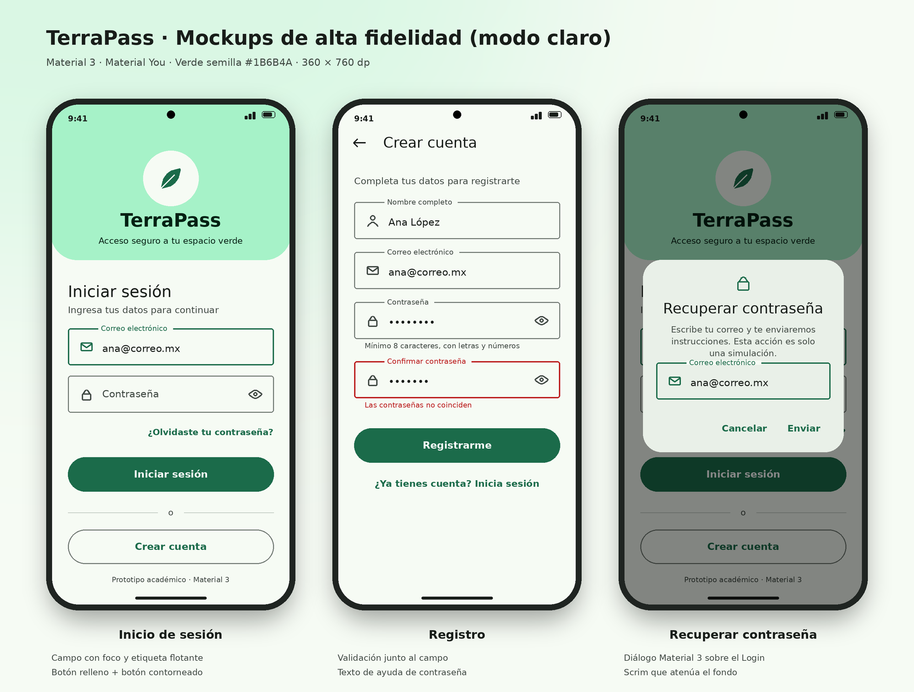
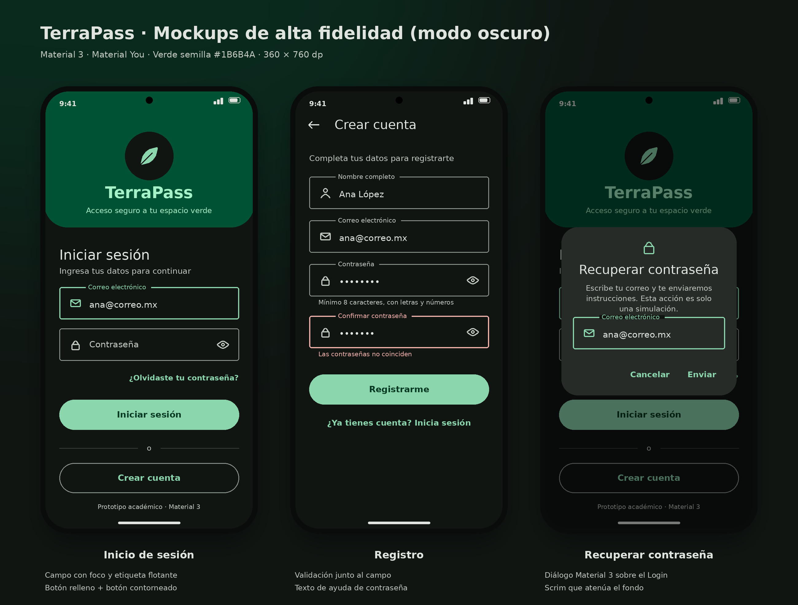

# TerraPass 🌿

**Prototipo de inicio de sesión y registro para Android**, desarrollado en Android Studio con Java, XML, **Material Design 3** y **Material You** (colores dinámicos).

> **Proyecto académico:** el inicio de sesión, el registro y la recuperación de contraseña son simulaciones. No hay autenticación real, base de datos de usuarios ni envío de correos.

## Funcionalidades

- **Login:** correo y contraseña con validación (obligatorios, formato de correo, mínimo 8 caracteres), indicador de progreso y paso a una pantalla de bienvenida.
- **Registro:** nombre, correo, contraseña (letras y números) y confirmación; devuelve el correo al Login.
- **Recuperación de contraseña:** diálogo Material 3 que permanece abierto si el correo no es válido.
- **Material 3:** campos delineados, botones (relleno, contorneado, texto, tonal), diálogo, tarjeta, barra superior, Snackbar.
- **Material You:** `DynamicColors` activado en `TerraPassApp`; en Android 12+ la app toma los colores del fondo de pantalla.
- **Modo claro y oscuro:** `res/values` y `res/values-night`.

## Fases de diseño

| Fase | Archivo |
|---|---|
| Arquitectura | `docs/imagenes/arquitectura.png`, `docs/imagenes/flujo_navegacion.png` |
| Bocetos | `docs/imagenes/boceto.png` |
| Wireframes | `docs/imagenes/wireframe.png` |
| Mockups | `docs/imagenes/mockup_claro.png`, `docs/imagenes/mockup_oscuro.png` |
| Paleta | `docs/imagenes/paleta_material3.png` |
| Documentación completa | `DOCUMENTACION.docx` |




## Tecnologías

Java 11 · XML · Material Components 3 · Gradle (Kotlin DSL) · JUnit 4 · Espresso

## Estructura

```text
app/src/main/
├── java/com/terrapass/login/
│   ├── TerraPassApp.java        (activa Material You)
│   ├── ui/  LoginActivity · RegistroActivity · HomeActivity
│   └── util/ Validador · Formularios
├── res/ layout · values · values-night · drawable · mipmap
└── AndroidManifest.xml
```

## Cómo ejecutar

1. Descarga el proyecto como ZIP y descomprímelo.
2. Abre la carpeta en Android Studio y espera la sincronización de Gradle.
3. Selecciona un emulador o dispositivo (API 24 o superior).
4. Ejecuta el módulo `app`.
5. Para las pruebas unitarias: `./gradlew test`.

Cualquier correo con formato válido y una contraseña de 8 o más caracteres permite entrar (es una simulación).

## Datos académicos

- **Institución:** Tecnológico de Estudios Superiores del Oriente del Estado de México
- **Carrera:** Ingeniería en Sistemas Computacionales
- **Materia:** Diseño y Desarrollo de Interfaces Móviles
- **Alumno:** Reyna Bello Eduardo Rodrigo
- **Profesor:** Gustavo Moisés Romero González
